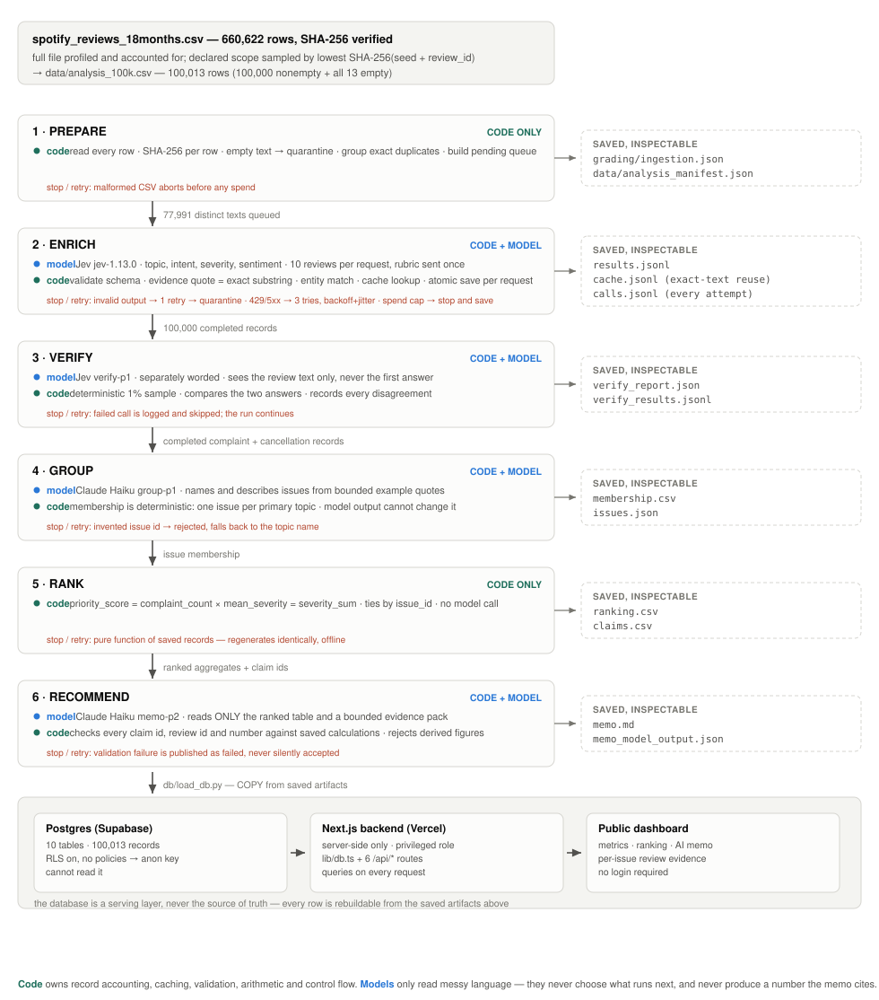

# Spotify Review Insight Pipeline

Turning 100,000 real Spotify Google Play reviews into a product-priority recommendation where every
number traces back to a specific review.

**Live dashboard: https://dashboard-seven-gamma-14.vercel.app** — public, no login required.
**Repo entry point:** this file.

> The dashboard is served by a Next.js backend on Vercel that queries Postgres (Supabase) on every
> request. Verified live: changing a row in the database changed the deployed page's output without a
> redeploy, so this is a real backend reading a real database, not a build-time snapshot.

> **Declared scope.** Assignment v2 requires at least 100,000 reviews. This project classifies a
> deterministic 100,000-review sample (plus all 13 empty-text rows) drawn from the full 660,622-row
> extract. The full file is still ingested, profiled and hashed. The grader's coverage formula divides
> by 660,622/660,609, so this scope earns a proportional coverage score of about **0.32 of 1 point** —
> a deliberate, disclosed trade-off, not an accounting gap. See [Scope and honest limits](#scope-and-honest-limits).

---

## Results at a glance

| | Measured |
|---|---|
| Rows accounted for | **100,013** — 100,000 classified, 13 quarantined (`empty_review_text`), 0 failures |
| Full-file profile | 660,622 rows, 13 empty, 159,701 missing app versions, 0 duplicate IDs — matches `manifest.json` |
| Enrichment cost / time | **$2.23**, 14 min wall clock, 8 workers, 7,800 requests |
| Exact-text reuse | 22,009 records reused from 77,991 distinct texts (verified by the official checker) |
| Golden-set agreement (n=50) | topic **0.90**, intent **0.92**, severity **0.82**, severity MAE **0.26** |
| Independent verifier (n=1,007) | topic **0.915**, intent **0.887**, severity **0.871** |
| Official `check_submission.py` | **`pass`** — zero issues |
| Total API spend, whole project | **$2.74** (Jev $2.64 + Claude Haiku $0.10) |

**Top priority: `ISS-usability`** — 12,408 complaints × 2.606383 mean severity = **32,340**.
Full memo: [`runs/main100k/memo.md`](runs/main100k/memo.md).

---

## Rubric map

| Criterion | Evidence |
|---|---|
| **D1** Accessible code & artifacts | This README, [`requirements.txt`](requirements.txt), stdlib-only core, [`.env.example`](.env.example) |
| **D2** Architecture, shared schema, provenance | [Architecture](#architecture), [`pipeline/labels.py`](pipeline/labels.py), [`docs/labels.md`](docs/labels.md), `source_sha256` + `cache_source_id` on every record |
| **D3** Memo numbers linked to calculations | [`grading/claims.csv`](grading/claims.csv), code validation in [`pipeline/memo.py`](pipeline/memo.py) |
| **D2b** One review traced end to end + one failed case | [`docs/trace.md`](docs/trace.md), regenerate with `python3 tools/trace_review.py <id> --md` |
| **D4** Recommendation, alternatives, limitations | [`runs/main100k/memo.md`](runs/main100k/memo.md) |
| **T1** 50 human labels, per-field comparison, error analysis | [`evals/golden_report.md`](evals/golden_report.md) (shipped config), [`evals/golden_report_p1.md`](evals/golden_report_p1.md) (per-review comparison), [`evals/golden_label_changes.md`](evals/golden_label_changes.md) |
| **T2** Independent verification + planted-error/injection tests | [`runs/main100k/verify_report.json`](runs/main100k/verify_report.json), [`evals/system_tests.py`](evals/system_tests.py), [`evals/system_tests_report.json`](evals/system_tests_report.json) |
| **T3** Real 100-review cold/warm pilot, calculator, controls | [`cost/report.md`](cost/report.md), [`cost/README.md`](cost/README.md) |
| **W1** Ingestion, coverage, classification | [`grading/ingestion.json`](grading/ingestion.json), self-check `pass` |
| **W2** Staged program, bounded calls, saved handoffs, resume | `python3 run.py pipeline` ([`pipeline/orchestrator.py`](pipeline/orchestrator.py)), [`tools/resume_demo.sh`](tools/resume_demo.sh), **[recording](docs/resume_demo.mov)**, [`grading/checkpoint_before.json`](grading/checkpoint_before.json), [`grading/checkpoint_after.json`](grading/checkpoint_after.json) |
| **W3** Reproducible ranking + deployed dashboard | `python3 run.py rank` ([`pipeline/rank.py`](pipeline/rank.py)), [live dashboard](https://dashboard-seven-gamma-14.vercel.app), [`dashboard/`](dashboard/README.md) |

---

## Architecture

<picture>
  <source media="(prefers-color-scheme: dark)" srcset="docs/architecture-dark.svg">
  
</picture>

<sub>Regenerate with `python3 tools/make_architecture_svg.py` — both themes come from one source of truth.</sub>

### Why each model call exists, and what code does instead

| Stage | Why a model is needed | What code does instead / around it |
|---|---|---|
| **Enrich** | Judging topic, intent and severity means reading messy, multilingual, often ungrammatical customer language. No rule set does this. | Code groups duplicate texts, validates the schema, extracts the evidence quote as an exact substring, matches entities by term, applies the contract's severity rules, caches, and saves after every request. |
| **Verify** | Checking a label requires the same language judgment as making one. A second role with different wording gives an independent read. | Code picks the sample deterministically, compares the two answers field by field, and records every disagreement. The model never sees the first answer. |
| **Group (naming)** | Turning a topic bucket into a product-legible issue name needs language judgment. | Code assigns membership deterministically — one issue per primary topic — so ranking never depends on a model, and rejects any issue ID the model invents. |
| **Recommend** | Weighing volume against severity and writing the argument is the one genuinely generative task. | Code computes every number **and every ordering** (rank by priority, severity and volume), hands the model only those plus a bounded evidence pack, then checks each cited claim ID, review ID, figure and order word ("highest", "second-lowest", "tied") against them. One bounded repair attempt; a memo that still fails is published as failed. |
| **Prepare / Rank** | **No model.** Counting, hashing, filtering, sorting and arithmetic are deterministic. | Pure code, so the ranking regenerates identically and offline. |

**The division of labour:** the model reads messy language; code owns record accounting, arithmetic,
caching, validation and every number that reaches the memo. Code decides what runs next at every
stage — the model never chooses the control flow.

---

## Efficiency, with measurements

| Technique | What it does | Measured effect |
|---|---|---|
| **Batching (10/request)** | Rubric travels once per request in `state`; 4 short questions per review | **1,732 → 664 input tokens per review (−62%)**; topic and intent agreement identical, severity 0.86 → 0.82 (2 cases of 50) |
| **Exact-text caching** | Keyed on text + model + prompt + schema | 22,009 of 100,000 records reused; warm pilot makes **0** new calls |
| **Work queue + resume** | Pending unique texts drained by a thread pool; completed work skipped on restart | Interrupted at 258 records, resumed to 500, **0** completed IDs re-sent |
| **Parallelism (8 workers)** | Shared spend ledger + shared token-bucket limiter | **2.7× faster at identical cost** on the same 500 reviews, cold both times |

**The one quality cost of batching.** Measured on the same 50 hand-labelled reviews, batching left
topic (0.90) and intent (0.92) agreement untouched but moved severity exact-match from 0.86 to 0.82 —
two cases out of fifty, which 50 cases cannot resolve as a real difference. Both evaluations are
committed ([`evals/golden_report.md`](evals/golden_report.md) for the shipped config,
[`evals/golden_report_p1.md`](evals/golden_report_p1.md) for per-review) so the trade-off is checkable
rather than asserted. The headline numbers in this README are the **shipped** config's.

The parallelism result is worth stating plainly: **more workers buy time, not money.** Cost is driven
by tokens, not wall clock. The speedup was 2.7× rather than 8× because the shared rate limiter — set
to 60% of Jev's published 100K tokens/second — becomes the binding constraint before the API does.

---

## Spending controls

Three independent layers, because one is not enough:

1. **Per-run cap** (`--max-spend`). Worst-case cost is *reserved before* each request; the request is
   refused and the run stops cleanly if spent + reserved + next would exceed the cap.
2. **Project-wide cap** in `state/ledger.json` ($4.00), persisted across every run.
3. **Provider-side**: prepaid credit with auto-recharge disabled.

Plus bounded retries (3 attempts with backoff and jitter for transport/429/5xx; exactly 1 retry for
invalid model output, then quarantine; immediate stop on 401/402/403/422), and timeouts counted at
their full reservation since their true cost is unknown.

---

## Data source

The course extract of **BwandoWando, *3.4 Million Spotify Google Store Reviews*, version 2** (Kaggle,
publisher-listed licence CC0: Public Domain), as supplied in the course dataset ZIP.

| | |
|---|---|
| Source | https://www.kaggle.com/datasets/bwandowando/3-4-million-spotify-google-store-reviews (version 2) |
| File | `spotify_reviews_18months.csv` — 660,622 rows, 97,400,616 bytes |
| **SHA-256** | `1fc85de68a304dd8978b537cfa58793d5f41cbaf417fa32cb53899f83a2fcef6` |
| Window | 2022-05-17 (inclusive) to 2023-11-17 (exclusive), per [`data/manifest.json`](data/manifest.json) |

The 97 MB CSV is not committed. Download the course ZIP, unzip it, and pass the CSV's path wherever a
command below says `<source csv>`. Every derived file is checksummed against it:
[`data/analysis_manifest.json`](data/analysis_manifest.json) records the declared 100k subset's rule,
seed and SHA-256, and the official checker confirms each row hash still matches the full file.

## Reproduce

```bash
cp .env.example .env            # add TYPESAFE_API_KEY and ANTHROPIC_API_KEY (only for paid runs)
pip install -r requirements.txt # only the Haiku roles and the DB loader need packages
```

**No API key, no database, no cost** — the checks a grader can run on a fresh clone:

```bash
python3 run.py rank                     # regenerate the ranking from grading/; prints "identical: True"
python3 cost/calculator.py              # offline cost replay from saved usage x editable rates
python3 evals/system_tests.py           # planted-error, malformed-output, spend-cap and other checks
python3 tools/trace_review.py 4c5dee86-808d-4414-932e-d01feeb8a64e --md   # one review, end to end
python3 reference/check_submission.py profile --full <source csv> --out grading/ingestion.json
```

**The pipeline itself** — one command, any input CSV, all six stages (ingest, enrich, verify,
group, rank, recommend). Without `--paid` it plans and estimates, then stops before any call:

```bash
python3 run.py pipeline --input data/cost_100.csv --out runs/demo                       # dry run
python3 run.py pipeline --input data/cost_100.csv --out runs/demo --paid --max-spend 0.10
```

The production run used the same stages on the declared scope:

```bash
python3 run.py pipeline --input data/analysis_100k.csv --out runs/main100k --paid --max-spend 3.20 --workers 8 --batch-size 10
python3 cost/calculator.py pilot        # real cold + warm 100-review pilot through the same orchestrator
bash tools/resume_demo.sh               # interruption and resume, with checkpoint snapshots
```

Rerunning a paid command on unchanged inputs is free: enrichment, verification, issue naming and
the memo are each cached by exact input and configuration, so a warm rerun makes no model calls.

## Result files

| Required | File |
|---|---|
| Ingestion report | [`grading/ingestion.json`](grading/ingestion.json) (official full-file profile), [`data/analysis_manifest.json`](data/analysis_manifest.json) |
| Enriched table | [`results/enriched.csv.gz`](results/enriched.csv.gz) — predictions joined with preserved source values |
| Quarantine log | [`results/quarantine.jsonl`](results/quarantine.jsonl) — 13 rows, reason `empty_review_text` |
| Issue → review membership | [`grading/membership.csv`](grading/membership.csv), names in [`results/issues.csv`](results/issues.csv) |
| Aggregates and ranking | [`results/aggregates.csv`](results/aggregates.csv), [`grading/ranking.csv`](grading/ranking.csv) |
| Claims cited by the memo | [`grading/claims.csv`](grading/claims.csv) |
| Run summary | [`results/run_summary.json`](results/run_summary.json) — attempts, failures, usage and cost by role |
| Interruption / resume | [recording](docs/resume_demo.mov) of `tools/resume_demo.sh`: 258 records saved → interrupted → resumed to 500, **0** completed IDs re-sent; checkpoints in `grading/` |
| Grading export | [`grading/`](grading/) — checker status `pass` |

---

## How the memo checker earned its keep

The memo role went through four prompt versions. Each fix came from a check catching a real error,
not from rewording until it looked right:

| Version | What went wrong | How it was caught | Fix |
|---|---|---|---|
| `memo-p1` | Cited billing's numbers under claim IDs that belong to other issues | Claim ↔ issue check | Claims are issue-scoped; the check enforces it |
| `memo-p1` | Wrote "40% higher" — a ratio no saved calculation contains | Number check | Derived figures forbidden in the prompt and rejected in code |
| `memo-p2` | **Swapped access and playback**: called playback (3.64) the highest mean severity and access (3.97) second, with every number correct | **Reading the prose by hand** — the number check passed it | Code now supplies each issue's rank by priority, severity and volume; the model may not infer orderings |
| `memo-p3` | Called access "second-lowest" by volume (it is third), usability "the largest cohort" (it is second) and "the majority" (it is 27%) | The new order-word check, after it was generalised from fixed phrases to *ordinal + direction + metric* | Explicit `ranks N of 8 by <metric>` phrasing; proportion words rejected |
| **`memo-p4`** | **Passes**, after one bounded repair round | — | Shipped |

The `memo-p2` case is the lesson: **a validator that checks numbers will pass a memo whose numbers
are all correct and whose argument is still wrong.** The previous versions are kept in
[`runs/main100k/memo.p2.md`](runs/main100k/memo.p2.md) so the before and after can be compared, and
a regression check confirms the current checker still rejects every error above. Qualitative
judgements ("materially severe", "acute") remain outside what code can verify, which is why a
person still reads the final argument.

## Scope and honest limits

- **Scope.** 100,000 nonempty reviews sampled by lowest `SHA-256(seed + review_id)`, plus all 13
  empty rows so the quarantine path is exercised. Monthly distribution stays within **0.105
  percentage points** of the full corpus, so trend comparisons remain valid. Rule and checksums:
  [`data/analysis_manifest.json`](data/analysis_manifest.json).
- **Coverage trade-off.** The grader's formula uses full-corpus denominators, so this scope scores
  ~0.32 of the 1 coverage point. Stated here rather than buried.
- **`ISS-other` is a mixed bucket** (14,389 complaints). Grouping by primary topic puts every generic
  complaint here. Splitting it into sub-issues is the clearest next improvement.
- **50 golden cases is a small diagnostic sample**, not a population accuracy estimate. Label
  revisions made after seeing model predictions are disclosed in
  [`evals/golden_label_changes.md`](evals/golden_label_changes.md).
- **What this data cannot support:** no revenue, plan tier, confirmed cancellations, or complete
  customer population. Cancellation language is stated *intent*, never observed churn. No revenue at
  risk and no causal retention claim appears anywhere in the memo — the memo role is instructed
  against it and code rejects derived figures.
- First and last calendar months of the window are partial; the dashboard marks them.

## Security

`.env` is git-ignored and contains the only real credentials. The repo carries a blank
[`.env.example`](.env.example). Database tables have row-level security enabled with no policies, so
the public anon key cannot read them; the dashboard reads server-side with a privileged role supplied
through the hosting environment, never shipped to the browser. Every grader-facing check — offline
cost replay, ranking regeneration, the submission checker — runs with **no credentials at all**.
